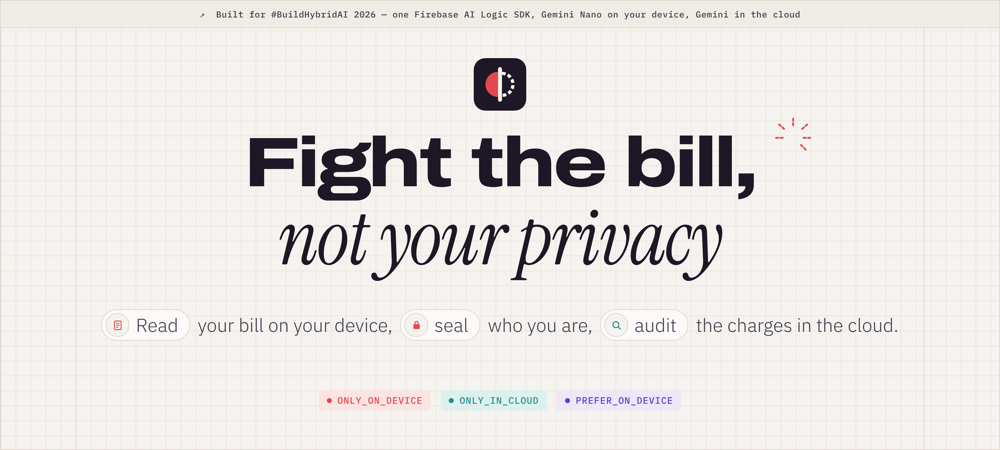
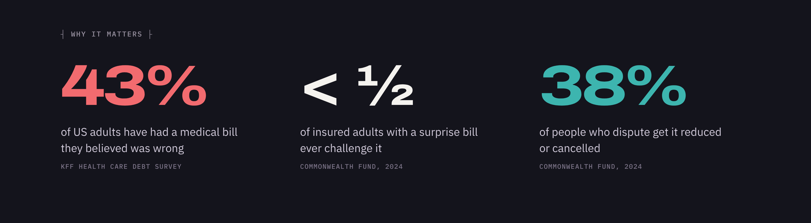
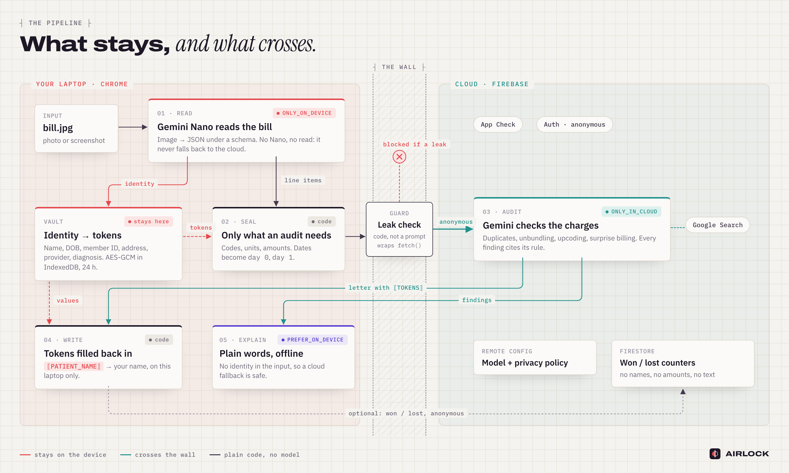
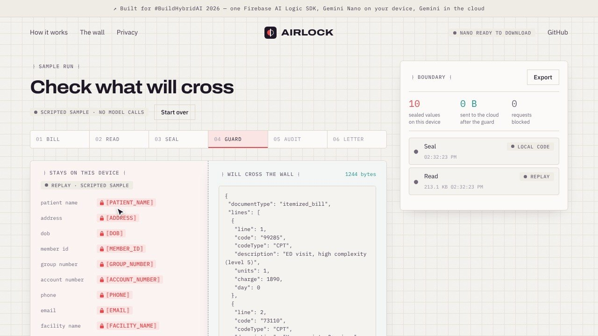
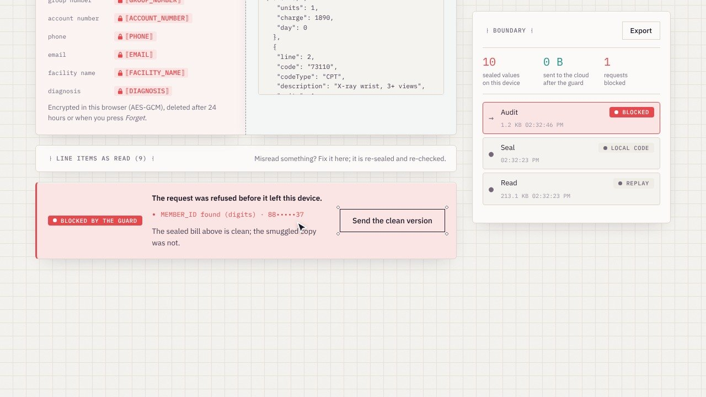
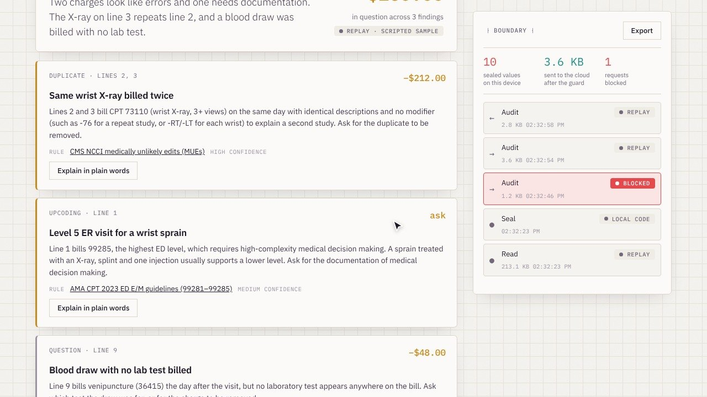
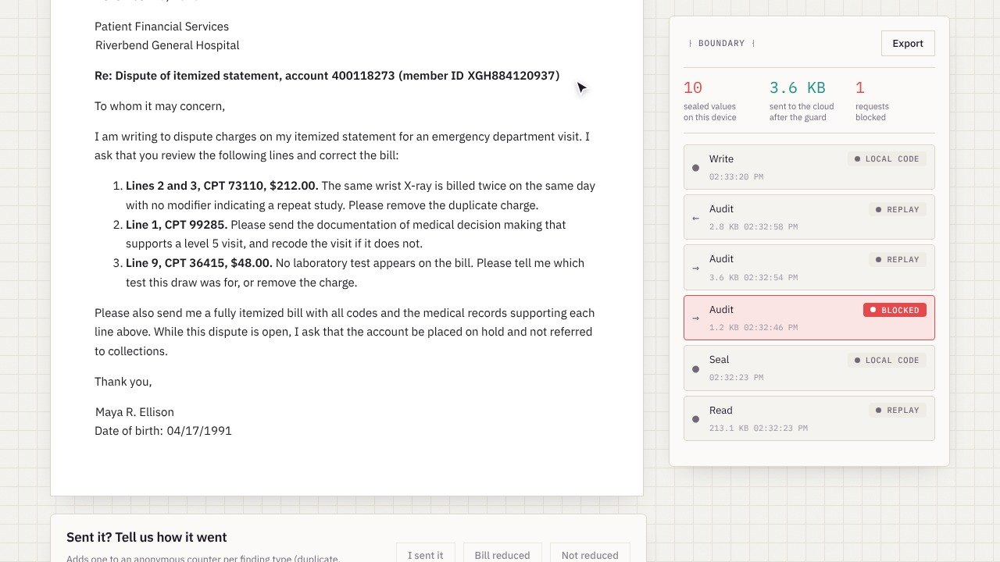

<p align="center">
  <picture>
    <source media="(prefers-color-scheme: dark)" srcset="brand/airlock-logo-dark.png">
    
  </picture>
</p>

<p align="center">
<a href="LICENSE"></a>


</p>

<p align="center">
<b>Live</b>: coming soon &nbsp;·&nbsp; <b>Film</b>: 2:45 (<a href="video/README.md">how it’s made</a>) &nbsp;·&nbsp; <a href="docs/deck/airlock-deck.pdf"><b>Deck</b></a> &nbsp;·&nbsp; <a href="docs/architecture.md"><b>Architecture</b></a> &nbsp;·&nbsp; <a href="docs/privacy.md"><b>Privacy model</b></a> &nbsp;·&nbsp; <a href="docs/business-case.md"><b>Business case</b></a>
</p>



**Airlock audits a medical bill and writes the dispute letter, and the parts of the bill that identify you never leave your device.** Gemini Nano reads the photo inside Chrome and seals your name, birthday, member ID and diagnosis into a vault on your laptop. Only anonymous codes and amounts cross to cloud Gemini, which checks them against real billing rules. Your details are filled back into the letter locally.



The work in between (reading codes, knowing the rules, writing the letter) is exactly what language models are good at. But asking one today means pasting your whole record into a chatbot. [Sources for every number.](docs/business-case.md)

## How it works



| | Step | Runs | Firebase AI Logic mode | Why this mode |
|:--:|---|---|---|---|
| **01** | **Read** the bill photo | Gemini Nano, in Chrome | `ONLY_ON_DEVICE` | The image holds your identity. If there's no Nano, Airlock stops; it never quietly falls back to the cloud |
| **02** | **Seal** identity into a vault | plain code | — | Tokens replace identifiers; dates become day offsets |
| **⛨** | **Guard** every request | plain code | — | Scans the exact outgoing bytes for every sealed value, written any way. One hit and the request is refused |
| **03** | **Audit** the charges | Gemini + Google Search | `ONLY_IN_CLOUD` | Needs current rules and a bigger model. Sees codes and amounts only |
| **04** | **Write** the letter | plain code | — | Placeholders are filled with your details on the device |
| **05** | **Explain** a finding | Nano, else Gemini | `PREFER_ON_DEVICE` | No identity in the input, so a cloud fallback is safe |

> [!IMPORTANT]
> **The trap most hybrid apps miss.** `PREFER_ON_DEVICE` sends the request to the cloud whenever the device has no model. For a photo of a medical bill, that silent fallback *is* the privacy failure. Airlock reads with `ONLY_ON_DEVICE` and handles the exception instead.

## See it

<table>
<tr>
<td width="50%"></td>
<td width="50%"></td>
</tr>
<tr>
<td><b>Sealed on the device.</b> Identity becomes tokens; the exact bytes that will cross are shown before anything is sent.</td>
<td><b>Blocked by the guard.</b> A member ID hidden in line 7 is caught as digits, and the request never leaves.</td>
</tr>
<tr>
<td></td>
<td></td>
</tr>
<tr>
<td><b>Audited in the cloud.</b> Every finding names its lines and the rule it relies on.</td>
<td><b>Written on the device.</b> The letter comes back with placeholders and is filled in locally.</td>
</tr>
</table>

<sub>Screens from the sample run: the real app with scripted model outputs, labelled as such in the app.</sub>

## Judge this in 90 seconds

1. **No setup:** open the live URL with `#/app?replay=1`. A scripted sample run on a fictional bill plays through every stage, clearly labelled.
2. **With Gemini Nano:** Chrome 139+ → `chrome://flags/#prompt-api-for-gemini-nano-multimodal-input` → **Enabled** → relaunch. Open the app, press **Prepare on-device model**, then **Use the sample bill**. The badge reads **● On device** for Read and **● In cloud** for Audit, straight from the SDK's `inferenceSource`.
3. **Try to break it:** add `&guard-demo=1` and press **Try to smuggle the member ID**. The request is refused and a red **Blocked** row appears in the boundary panel.
4. **Check it yourself:** DevTools → Network → the Gemini request. Search it for *Ellison*. It isn't there.

## Built on Firebase

| Product | Job in Airlock |
|---|---|
| **Firebase AI Logic** | One SDK, three inference modes, each chosen for the data it handles |
| **App Check** | reCAPTCHA Enterprise in front of AI Logic |
| **Authentication** | Anonymous sign-in, required for the only Firestore write |
| **Remote Config** | Cloud model name, redaction strictness and privacy switches without a redeploy |
| **Firestore** | Anonymous outcome counters (finding type × won / lost), increment-only rules |
| **Hosting** | The app, behind a strict Content Security Policy: no third-party scripts, nowhere for a bill to go |

## Run it locally

```bash
cd web
cp .env.example .env.local     # Firebase web config: see docs/human-runbook.md
npm ci
npm run dev                    # http://localhost:5173  (add #/app?replay=1 to try it without Firebase)
npm run check                  # typecheck + lint + 54 tests
```

<details>
<summary><b>What's in the repository</b></summary>

| Folder | Contents |
|---|---|
| [`web/src/airlock/`](web/src/airlock) | The privacy core: vault, sweep, guard, ledger. Pure functions, fully tested, including property tests that smuggle generated identities through in seven formats |
| [`web/src/ai/`](web/src/ai) | Firebase setup and the three model stages, plus the fetch-level guard |
| [`web/src/app/`](web/src/app) · [`web/src/landing/`](web/src/landing) | The checker flow and the landing page |
| [`docs/`](docs) | Plan, architecture, privacy model, business case, design system, demo script, runbook, deck |
| [`video/`](video) | The demo film, built from code: voiceover, screen capture, frames, mix |
| [`brand/`](brand) | Logo, mark, favicon |
| `firebase.json` · `firestore.rules` · `remoteconfig.template.json` | Hosting, rules and policy |

</details>

## Licence

[Apache-2.0](LICENSE). The patient, bill and hospital in every sample are fictional. Airlock isn't legal or medical advice: findings are questions to put to your billing office. Music in the film: Sascha Ende, ende.app (CC BY 4.0).
