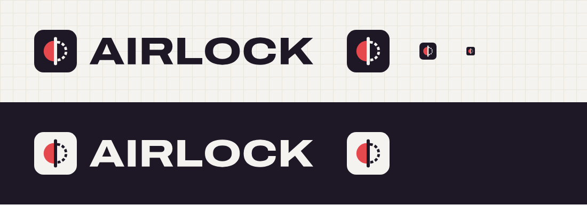

# Airlock brand

**The mark.** One dot, cut by a wall. The solid coral half is your identity: it stays on your device. The dashed half is everything else in the document, with the identity removed: that part may go to the cloud. The wall is the airlock.

| File | Use |
|---|---|
| `airlock-logo.svg` / `.png` | Primary lockup on light backgrounds |
| `airlock-logo-dark.svg` / `.png` | Lockup on dark backgrounds |
| `airlock-mark.svg` / `.png` | App icon, avatar, social |
| `airlock-mark-dark.svg` | Icon on dark backgrounds |
| `favicon.svg` | Browser tab (64×64 grid, legible at 16px) |
| `airlock-wordmark.svg` | Wordmark alone |

All text is outlined to paths, so the SVGs render the same everywhere without a font.

## Colour

| Token | Hex | Meaning |
|---|---|---|
| `ink` | `#1D1726` | Text, tile |
| `paper` | `#F5F3EF` | Background |
| `coral` | `#E5484D` | **Private.** Data that never leaves the device |
| `teal` | `#21918C` | **Cleared.** Redacted data allowed to cross to the cloud |

## Type

- Wordmark and display: **Archivo**, width 125, weight 800 (extended grotesque)
- Display accent: **Instrument Serif Italic**
- UI: **IBM Plex Sans** · labels and data: **IBM Plex Mono**

All four are open-source (SIL OFL).
