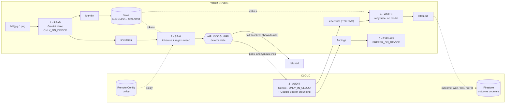

# Architecture

Airlock is a static web app (Vite + React + TypeScript) on Firebase Hosting. There is no server of ours: every model call goes through the Firebase AI Logic client SDK, which talks to Gemini Nano in Chrome (the Prompt API) or to the Gemini Developer API in the cloud, protected by App Check.

## The pipeline



## Inference modes, by stage

| Stage | Firebase AI Logic call | Input | Output | Leaves the device? |
|---|---|---|---|---|
| 1 Read | `getGenerativeModel(ai, { mode: ONLY_ON_DEVICE, onDeviceParams: { createOptions: { expectedInputs: [{type:'text'},{type:'image'}] }, promptOptions: { responseConstraint: BILL_SCHEMA } } })` | bill image | `{ identity, lines[], totals, plan, denial_codes }` | **Never.** `ONLY_ON_DEVICE` throws instead of falling back |
| 2 Seal | none | identity, lines | sealed lines + vault | No |
| 3 Audit | `getGenerativeModel(ai, { mode: ONLY_IN_CLOUD, inCloudParams: { model: rc.cloud_model, tools: [{ googleSearch: {} }], generationConfig: { responseMimeType: 'application/json', responseSchema: AUDIT_SCHEMA } } })` | sealed lines (guard-checked) | `{ findings[], letter_markdown }` with tokens | **Yes, only what the guard passed** |
| 4 Write | none | letter with tokens + vault | final letter | No |
| 5 Explain | `getGenerativeModel(ai, { mode: PREFER_ON_DEVICE, inCloudParams: { model: rc.cloud_model } })` | one finding (no identity) | plain-language paragraph | Only if Nano is unavailable, and the input has no identity |

Every result is wrapped as `{ data, source: response.inferenceSource }` and the UI badge reads `source`. We never infer it.

## Why Read is `ONLY_ON_DEVICE` and not `PREFER_ON_DEVICE`

With `PREFER_ON_DEVICE`, the SDK sends the request to the cloud whenever Nano is unavailable, still downloading, or the request shape isn't supported on-device. For a photo of a medical bill, that silent fallback is the privacy failure. `ONLY_ON_DEVICE` turns it into an exception we can handle: Airlock offers the manual airlock instead (black-box the identity on a canvas, approve the exact pixels that cross). This is the core design decision.

## The guard

```ts
guard(body: string, vault: Vault): { ok: boolean; leaks: Leak[] }
```

- Runs on the exact serialised request body, after the SDK request is built and before it is sent. A custom `fetch` wrapper is the last stop, so nothing can bypass it.
- Checks every vault value plus normalised variants: case-folded, whitespace and punctuation removed, digits only (IDs, phones, ZIPs), the last 6 digits of IDs of 9+ digits, `Lastname, First` / `F. Lastname` / each name part as a whole word, a ZIP only next to its state (bare ZIPs collide with CPT codes), the date in ISO, US and long formats.
- On any hit it throws `AirlockBreach`, writes a `blocked` ledger row with the variant matched (shown masked), and the UI shows the user the exact field.

## Client modules

```
web/src/
  airlock/        vault.ts  sweep.ts  guard.ts  ledger.ts  types.ts   ← pure, fully tested
  ai/             firebase.ts  stages.ts  schemas.ts  prompts/*.txt  replay.ts
  app/            Upload  ReadStep  SealStep  CrossStep  Findings  Letter  Outcome  Boundary
  landing/        Hero  Chips  Wall  HowItWorks  Numbers  FAQ  Footer
  theme.css  motion.ts  main.tsx  App.tsx
```

## Firebase surface

| Product | Config | Notes |
|---|---|---|
| AI Logic | `getAI(app, { backend: new GoogleAIBackend() })` | Gemini Developer API; App Check token attached automatically |
| App Check | `ReCaptchaEnterpriseProvider(siteKey)`, `isTokenAutoRefreshEnabled: true` | Debug token via `self.FIREBASE_APPCHECK_DEBUG_TOKEN` when `?debug-appcheck=1` |
| Auth | `signInAnonymously` on first load | uid only used by Firestore rules |
| Remote Config | `minimumFetchIntervalMillis: 3600000`, in-code defaults | fetched once per session |
| Firestore | `outcomes/{findingType}` `{ disputed, won, lost }` | rules: signed in, only `increment(1)` on one field per write |
| Hosting | `web/dist`, SPA rewrite, CSP header | |

## Content Security Policy (Hosting header)

`default-src 'self'; connect-src 'self' https://*.googleapis.com https://*.firebaseio.com https://www.google.com; img-src 'self' blob: data:; script-src 'self' https://www.google.com https://www.gstatic.com; frame-src https://www.google.com; style-src 'self' 'unsafe-inline' https://fonts.googleapis.com; font-src https://fonts.gstatic.com`

There are no third-party analytics and no other network destinations, so the bill can't reach anywhere the guard doesn't watch.
